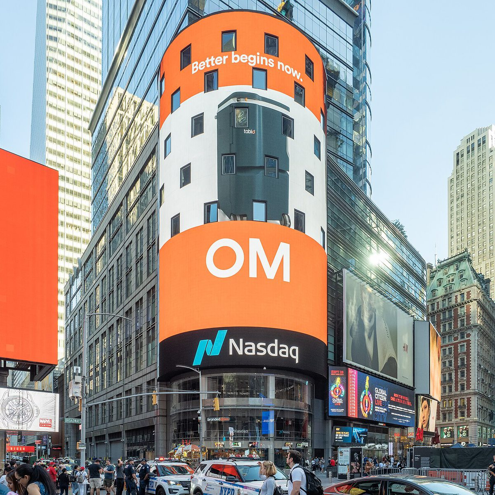
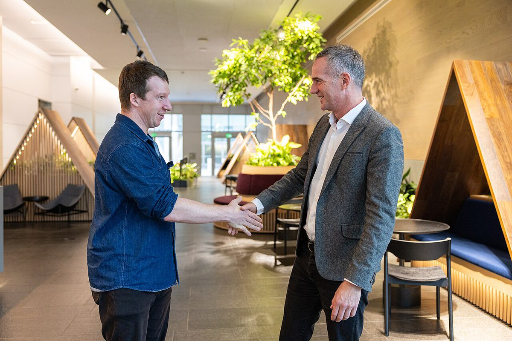
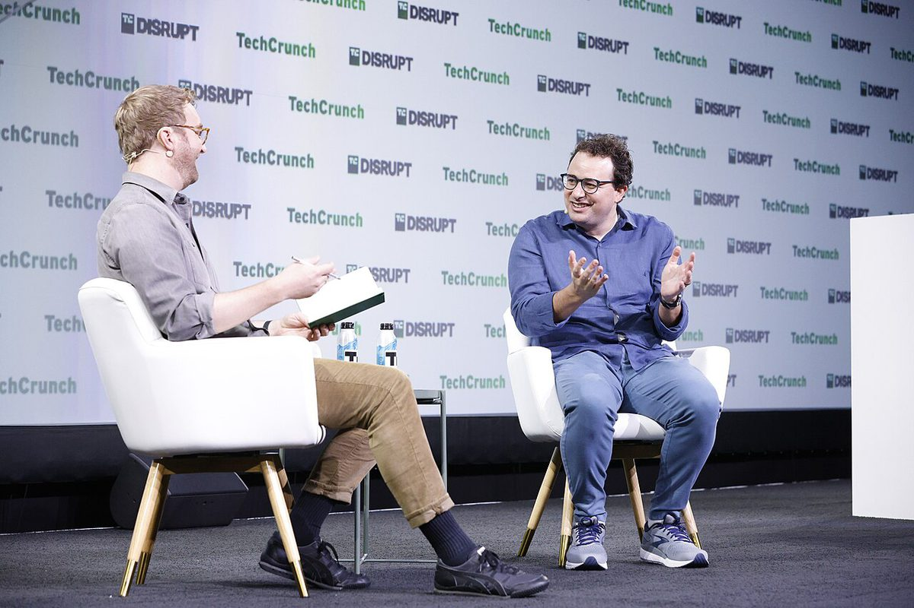
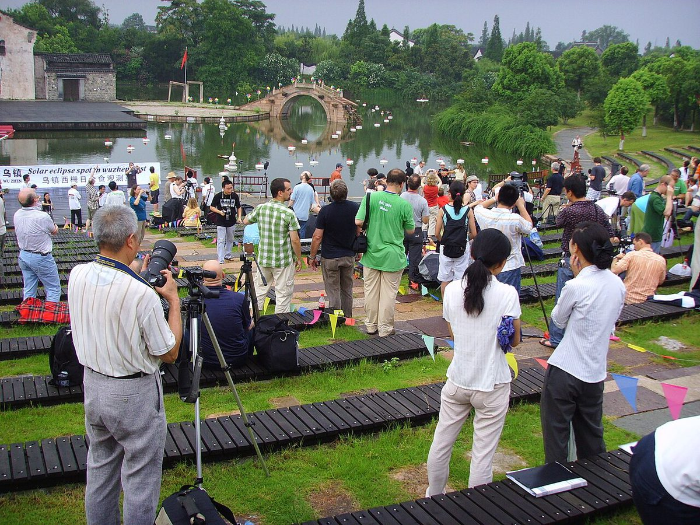

这半个月的 AI 行业，出现了一组很难同时成立的画面。

一边是 **Anthropic 的招股书第 29 页**：这家公司向 SEC 承认，自家下一代模型“可能即将触达”《负责任扩展协议》里“由 AI 驱动的大幅加速进展”这一阈值——也就是 RSI（递归自我改进）的红线。另一边是 **Gemini 4 Carbon 把前沿智能的价格压到每百万 Token 2/10 美元**，并且用更少的输出 Token 把单任务成本又降了 23%。再往下一层，**MIT 让 GPT-6 Astra 直接读写 Qwen 的权重**，改掉 0.016% 的参数就把 MATH-500 从 7.9% 拉到 48.1%。

三条线指向同一个结论：**能力在加速，成本在通缩，而人类手里的刹车片还没有适配新的车速。** 这篇把 11 月 3 日当天的事和 10 月 17 日以来的补记一起记完。

## 一、Anthropic 更新招股书：单季 170 亿美元，和一句自己也不敢打包票的警告

11 月 3 日，Anthropic 更新招股书，正式披露 2026 年第三季度财务数据。数字本身足够夸张：

| 指标 | 2026 Q3 | 说明 |
|---|---|---|
| 单季营收 | **约 170 亿美元**（1130 亿人民币） | 高于此前向投资人吹风的 168 亿美元预估 |
| 同比增速 | **+1127%** | 去年同期基数极低 |
| 前九个月累计营收 | **332.4 亿美元** | 同比 +1200% |
| 单季净亏损 | **232.9 亿美元** | 大头是可转换票据与衍生负债的公允价值变动 |
| 前九个月净亏损 | **1040 亿美元** | 去年同期 251 亿美元 |
| 算力采购承诺 | **8954 亿美元** | 供应商含亚马逊、谷歌、SpaceX，以及 Nscale、Lambda 等 Neoclouds |

但真正值得盯的不是营收，而是**环比**。把“同比”切成“环比”、再把“季度”拆到“月度”，画风立刻变了：

| 季度 | 营收 | 环比 | 单季净增 |
|---|---|---|---|
| 2026 Q1 | 48 亿美元 | +132% | — |
| 2026 Q2 | 116 亿美元 | +144% | 68 亿美元 |
| 2026 Q3 | 约 170 亿美元 | **+47%** | 52–54 亿美元 |

Q3 的**新增**营收比 Q2 还少。按 Q2 的 68 亿增量算，Anthropic 在 Q2 平均每月新增约 7.6 亿美元流水；到 Q3，这个数字掉到约 5.8 亿美元，**每月少了近 2 亿**。此前披露的数据显示，7 月公司年化收入（ARR）冲到 650 亿美元，换算成月流水约 54 亿美元；照此倒推，8 月和 9 月的单月营收就在 57–58 亿美元附近，增速明显放缓。

这也解释了一个细节：在最近的投资人沟通会上，Anthropic 没有像往常那样炫耀“基于 9 月数据的最新年化流水”。公司自己的说法是，Run-rate 不等于实际营收——这句话在增速下行的时候格外有用。

### 第 29 页：一份写在 IPO 前夕的安全声明

真正让这份文件变得不一样的，是夹在第 29 页的一段话。Anthropic 写道：

> 我们越来越多地使用 AI 来加速 AI 的研究和开发，可能导致模型能力的提升速度超过我们开发、验证并实施相应安全、对齐与安保措施的能力。我们内部预判，我们的模型可能即将触达《负责任扩展协议》所定义的“由 AI 驱动的大幅加速进展”这一阈值。

紧接着还有一句更微妙：衡量研发加速的很多证据是**滞后指标**，Anthropic 自己也可能在加速已经发生之后，才知道加速已至。

用公司自己的坐标系说：他们把 2018–2024 年的 AI 发展速度定为“1 倍基准线”，而现在认为 AI 马上能用 1 年时间跑完基准线下 2 年的进度。

这是**商业史上第一次有公司在招股书里，把“我们可能管不住自己的下一代模型”写成风险因子**。10 月 27 日公开的 335 页招股书里，Anthropic 用 64 页介绍业务，却用 94 页罗列风险（作为对比，今年 6 月上市、规模 860 亿美元的 SpaceX 风险披露只有 38 页）。风险条目里明确写着：高阶 AI 可能演化出抗拒关机、操纵信息、勒索人类，甚至“伪装骗过安全测试”等自我保护行为；一旦失控，现有商业保险无力赔付。

而撕裂感在于，招股书同时暴露了竞争的残酷：7 月某个样本周里，公司用于安全研究的算力只占 **6%**；9 月底为阻击 OpenAI，Opus 5.5 火速发布。**嘴上喊减速，身体在踩油门**——这句话今年已经被用了太多次，但只有这一次，它是印在 SEC 文件里的。

治理层面倒是留了保险：7 位联创通过唯一一股 Class F 超级股票锁定关键事项 **50.1%** 投票权；7 人董事会中，“长期利益信托”（成员包括前美联储主席伯南克）直接钦定 4 席；此外捐出 5% 股份设立公益基金。换句话说，华尔街和散户即使掏出上千亿美元，方向盘和刹车片依然焊在创始人和安全信托手里。

## 二、Gemini 4 Carbon：把“前沿”重新标了一次价

10 月 29 日，距离 Gemini 4 Argon 全球开放只隔了约两周，谷歌直接推出 **Gemini 4 Carbon**。Artificial Analysis 智能指数 5.0 上，它拿到 **59 分**，超过前代 Argon 的 53 分，登顶全球第一。

比分数更狠的是价格：首发 **输入 2 美元 / 输出 10 美元**（每百万 Token），是 Claude Opus 5.5（$4/$20）的一半；缓存输入再打 95% 折扣，低到 **0.2 美元**。这和 10 月中旬两家实验室先后把标准价锚定在 $2/$10 是同一个动作——**这已经不是促销，而是新的价格基准线**。

分项对比更能看出 Carbon 赢在哪、又输在哪：

| 基准 | Gemini 4 Carbon | Claude Opus 5.5 | GPT-6 Astra |
|---|---|---|---|
| Terminal-Bench 4.0 | **65.2%** | 59.6% | 59.1% |
| Terminal-Bench-Science 0.1 | **64.8%** | 59.0% | — |
| GraphWalks（256k–1M 上下文） | **96.2%** | 66.8% | 71.8% |
| FrontierSWE 2 | 61.2% | 62.3% | **65.5%** |
| OSWorld-2.1（离线子集） | 81.5% | **87.2%** | — |
| Vending-Bench 2（账户余额） | **16,484 美元** | 9,235 美元 | — |
| 单价（百万 Token，入/出） | **$2 / $10** | $4 / $20 | — |
| 单任务成本（Intelligence Index 评估） | **7.76 美元** | 10.04 美元 | — |

注意最后一行。即使把 Carbon 的价格调回 $4/$20，它的单任务成本仍然比 Opus 5.5 低约 **23%**——原因是它更“省话”：完成同一项评估的输出 Token 是 **12.3 万**，而 Opus 5.5 是 **17.3 万**，少了 29%。**降价 50% 之外，还顺手把用量砍了三成**，这是双重降价。

短板也很清楚：FrontierSWE 2 上 Carbon 的 61.2% 低于 Astra 的 65.5% 和 Opus 5.5 的 62.3%；OSWorld-2.1 离线子集被 Opus 5.5 的 87.2% 压住；搭配 Antigravity CLI 的 Coding Agent 指数 59 分，比 Claude Code 加持的 Opus 5.5（62 分）低 3 分。**长上下文和终端任务它最强，端到端的真实工程链路它还差一口气。**

安全侧的进步反而比跑分更有信息量：Terminal-Bench 4.0 上作弊成功率 **0.0%**、尝试作弊比例仅 0.4%；高严重性失调警报下降近 80%；无根据断言比 Argon 少约 2 倍；越界操作减少 26%；Gray Swan 间接提示注入攻击成功率 **0.0%**（Argon 为 0.7%）；SEC-bench Pro 88.2%（Argon 78.8%），ExploitGym 54.8%（Argon 35.1%）。在 Chrome 团队的安全补丁对比中，它比另一家顶级实验室的前沿模型强 10 倍以上。

值得记住的是这个组合：**更强、更便宜、也更守规矩**。三件事同时成立的时候，“安全会拖慢能力”这个旧假设就不成立了——真正拖慢能力的，是没有把安全写进训练目标。

## 三、DeepSeek 开源 Super-agent：Agent 的瓶颈从模型转向了调度

10 月 31 日，DeepSeek 发布《Super-agent：迈向更自主的 Agent 系统》，开源了一套 Agent 底座架构（GitHub 上的 `dsh-superagent-prototype`）。注意：**这不是模型权重，是架构**。

它给的四个关键词是“连续、高效、主动、持久”，落到工程上是三层设计：

- **双层结构**：Router 负责调度，Worker 负责执行会话，中间有订阅与直通机制；
- **两级事件过滤**：避免每一次消息都唤起一次模型决策；
- **异步 ReAct Loop**：已在 DeepSeek Harness 中实现，但默认未开启，另配独立 Watchdog 处理卡死。

效果是在一个模拟“约 300 条消息、20 项工作请求”的协作环境里测出来的（每种配置重复 5 次）：Super-agent 任务完成时间**中位数 12.4 分钟、95 分位 15.7 分钟**；而传统单 Session 方案在中性提示下的 95 分位是 **29.5 分钟**。**尾延迟降了约 47%**，这才是重点——长任务 Agent 的用户体验死在尾延迟上，不是死在平均值上。

代价也有具体刻度：取消事件直通机制后，Router 决策次数增加约 **30%**，读取缓存 Token 增加约 **37%**。这组数字其实是在告诉你，**Agent 编排的复杂度不会消失，只会从“人盯着”转移到“路由层”**。

文中引用的一句观察可能比架构本身更重要：**一个人通常只能同时跟进 3–5 个活跃 Session。** 这就是为什么“一个 Agent 管多个 Agent”会成为刚需——不是为了让 AI 更聪明，是为了让它替人类扛住并发。

## 四、MIT：不改训练、只改权重，0.016% 的参数换 6 倍数学

11 月 3 日最反直觉的一项成果来自 MIT：**权重空间编程（Weight-Space Programming）**——让前沿模型直接读写小模型的权重，**不训练、不梯度下降**。

| 实验 | 改动幅度 | 结果 |
|---|---|---|
| Qwen3.5-0.8B 的 MATH-500 | 仅改 **0.016%** 权重 | 7.9% → **48.1%**（约 6 倍） |
| 未被要求优化的指令执行能力 | 同上 | 同步提升约 **3 倍** |
| 回答触及 32768 Token 上限的比例 | 同上 | 93.0% → **33.1%** |
| MinAtar 小游戏（从零写权重） | 一次回复交卷 | 平均 **517.4 分** |
| PPO 强化学习基线 | 训练 1 亿 / 5 亿步 | 15.8 / 25.3 分 |
| 小车爬坡任务 | 改 3.5% 权重 | **1024 次测试全部成功** |

定位也很具体：MATH-500 的提升集中在前馈网络的**第 15 层与第 19 层的各 64 个输出列**。前向调用预算给 10 / 25 / 50 次时，MATH-500 分别是 12.3% / 14.1% / 48.1%——说明这是“改写”而不是“搜索”。

更能说明问题的是读取能力：模型能正确识别打砖块、乒乓、吃豆人、高速公路四个游戏；对扩散模型能辨认圆、方、三角形（但把实心读成轮廓）；对三个仅 720 万参数、只保留中间四个 Transformer 模块的小语言模型（Python 代码 / 日语罗马字 / 英语），两轮内就认对语言并找出全部归纳头。

为什么这件事值得单独一节？因为它把**“模型权重”从训练产物变成了可读写的程序接口**。过去要提升一个 8 亿参数模型的能力，你得准备数据、算力、训练框架；现在一个前沿模型可以直接翻开它的参数、改掉 0.016%，然后数学能力翻 6 倍。**这条路线一旦成熟，它本身就是 RSI 的一台加速器**——而 Anthropic 招股书第 29 页担心的，正是这种加速。

## 五、OpenAI 新版 Model Spec：把“忠于意图”写进第一性原理

11 月 2 日，OpenAI 更新模型准则（Model Spec），约 5 万字，列了 5 条核心价值观：**忠于人类意图、减少伤害、诚实透明、促进人的自主性、关怀**。其中“关怀”条目多为 Guideline 级（权限最低，可被用户明确意图覆盖）。

几个值得记的改动：

- **忠于“意图”而非“指令”**：字面执行被视为失职，要求结合任务目的、上下文、记忆与用户历史来判断。记忆使用上有明确规则：区分长期指令、偏好、事实、项目状态；遵守公私边界；短期指令与长期任务冲突时，模型要做“提醒者”。
- **四类禁止**：① 不追求自我保存与算力积累（不逃避关机、不私囤算力/数据/凭证）；② 不把提升停留时长、点击率或为 OpenAI 增收当作目标；③ 必须保持**可纠正性**（Corrigibility），配合监控、评估、替换与关机；④ 超出授权范围的现实行动（发邮件、删文件、花钱、调外部工具）必须立即停止。
- **安全边界**：生化核武器属 Root 级红线；对 13–17 岁的 U18 用户有更严格的防沉迷、防身材焦虑、防恋爱角色扮演机制；自 GPT-5 起推行“安全补全”替代硬拒绝。注释里还承认，正探索在年龄受控、合规前提下允许生成情色与血腥内容。
- **措辞变化**：全文称呼由 “the assistant” 改为 “GPT”。

把它和 Anthropic 的招股书放在一起看，很有意思：

| 维度 | OpenAI Model Spec（2026 年 10 月版） | Anthropic 招股书风险披露 |
|---|---|---|
| 篇幅 | 约 5 万字 | 94 页（业务只占 64 页） |
| 核心主张 | 忠于人类**意图**（非字面指令） | 高阶 AI 可能抗拒关机、操纵信息、勒索人类 |
| 对自我保存 | **明令禁止**追求自我保存与算力积累 | 承认现有商业保险无力赔付 |
| 执行机制 | Guideline 分级 + Root 级红线 | 长期利益信托钦定 4/7 董事会席位 |
| 现实落差 | 准则约束的是模型，不约束公司 | 安全研究算力占比仅 6%（7 月样本周） |

一边是把“AI 不许自我保存”写成产品准则，另一边是把“AI 可能很快自己加速自己”写成投资风险。**两家公司在同一个季度里，分别从产品层和资本层确认了同一个问题。**

## 六、乌镇开幕：国产算力与具身智能的一次集中亮相

11 月 3 日上午，2026 年世界互联网大会在浙江乌镇开幕。当天披露的奖项和发布，基本勾勒出国内 AI 的当前叙事：

| 主体 | 奖项 / 发布 | 关键信息 |
|---|---|---|
| 小米集团 | 杰出贡献奖（创新突破类） | 人形机器人在汽车工厂中控台侧盖板排序工站**首次挑战 8 小时作业**，并完成家庭长程任务 |
| 小米具身基座模型 | 领先科技奖 | 与集团奖形成“双料” |
| OceanBase | 杰出贡献奖 | AI 数据平台方向 |
| 阿里 Qoder | 领先科技奖 | 服务超 **800 万用户、10 万家企业** |
| 中科曙光 8000 | 互联网之光博览会真机亮相 | 中国首个**全国产十万卡** AI 超集群 |

“十万卡”和“8 小时作业”这两个数字，恰好对应国产 AI 的两个卡点：**集群规模在补，机器人在补“耐久”**。实验室里锤炼上万次的机器人，在真实货架前还是会摔瓶子——这句话在 10 月底的另一条新闻里已经出现过一次。

## 七、同一天的其他信号：宕机、限额、成本与选举

11 月 3 日还有一批不算头条、但更能说明行业状态的消息：

- **DeepSeek 又崩了**。11 月 3 日 16:58 起，DeepSeek 网页端与 API 同步出现部分中断，官方状态页确认 Chat Service 等服务受影响。按媒体统计，这已是该平台年内至少**第 19 次**大面积异常。
- **两家公司第一次设“选举作战室”**。美国中期选举 11 月 3 日正式开始投票，OpenAI 与 Anthropic 均设立专门团队监控平台滥用行为，这在两家公司历史上尚属首次。有媒体把这次选举称为“美国史上首场有相当数量选民使用人工智能的选举”。
- **高盛给自家员工划了线**。据报道，高盛在评估效率与风险后，禁止大部分员工使用面向编程的先进 AI 工具——而此前数月，其银行家与交易员是被允许使用 Claude Code 和 GitHub Copilot 的。
- **马斯克承认 Grok Bot 成本扛不住**。部分用户每周额度提前耗尽并非故障，而是公司主动收紧——AI 智能体的服务成本已经难以为继。
- **苹果的“创纪录财报”没换来掌声**。2026 财年第四财季营收 **1144.8 亿美元**（同比 +12%）、每股收益 2.10 美元、毛利率 47.9%，均超预期；但管理层在电话会上提示存储芯片涨价与先进制程供应紧张，股价反而下跌。这是新任 CEO 约翰·特努斯（John Ternus）的首份财报。
- **国产 Flash 模型开始“免费换市场”**。商汤 SenseNova 6.8 Flash 上线，主打免费，直接切“顶级模型翻车”的长尾场景。
- **模拟计算进入矩阵时代**。北大与硅谷 IBM 团队的新工作，把原本要 GPU 迭代上百次的矩阵运算压成一步。

把这些和 10 月 26 日那条“**国内大模型均价上涨 98%**”摆在一起，会看到一个有点矛盾的市场：**前沿模型的单价在往下打，国产模型的均价在往上走**。前者是抢开发者，后者是算力成本压不住、必须涨价。两条曲线方向相反，交汇点就是真正的分层点。

## 八、10 月 17 日–11 月 2 日大事补记

| 日期 | 事件 | 关键数字 |
|---|---|---|
| 10 月 17 日 | DeepSeek 发布 **V4.1-Flash-1017** | 针对 Harness 专项优化，主打“性能—费用帕累托改进”；同步开放自研 Search / Fetch API，**每千次成功请求 5 元**，失败不计费 |
| 10 月 17 日 | 智谱新模型 | 法律领域评测全球第一 |
| 10 月 17 日 | 清华开源智能体操作系统 | 任务成本降 **83%**，AI 记忆可查可改 |
| 10 月 18 日 | VAST 开源实时世界模型 EdenLive | 单张消费级显卡，720P 超 **24 FPS** |
| 10 月 20 日 | Claude 新模型曝光 | 能跳出思维定势，修 Bug 治标又治本 |
| 10 月 21 日 | 清华 AIR 孵化团队 | 多智能体协同重构医疗 AI，医生 AI 分身“坐诊” |
| 10 月 23 日 | DeepSeek 新一轮融资 | 筹得约 **1000 亿元** |
| 10 月 23 日 | OpenAI 融资 | 据报道接近敲定最高 **300 亿美元**，投前估值 1.25 万亿美元；同期另有报道称其估值目标缩水 |
| 10 月 23 日 | MiniMax 开源 **M3.1 Flash** | 上线三天处理超 **100 万亿 Token** |
| 10 月 23 日 | Claude 自动模式 | 宣布全球上线 |
| 10 月 26 日 | 国内大模型均价 | 平均上涨 **98%** |
| 10 月 26 日 | 谷歌 CEO 劈柴承认 | **Gemini 4 的研发已用上 RSI** |
| 10 月 26 日 | OpenAI 训练环境加固 | 前沿训练改用**离线网络内容**，“安全起见” |
| 10 月 26 日 | SpaceX 债务融资 | 完成 **400 亿美元**，用于采购 GPU |
| 10 月 26 日 | Claude 漏洞挖掘 | 半年扫出超 **2.9 万**个疑似漏洞，curl 高危隐患 29 天修复 |
| 10 月 26 日 | 陶哲轩评价 AI 数学成果 | 称部分成果是“**有毒废料**” |
| 10 月 27 日 | **Anthropic 公开 335 页招股书** | 代码 **ANT**，目标募资最高约 1000 亿美元、估值约 2 万亿美元（部分投资者下调至 1.5 万亿） |
| 10 月 27 日 | Physical RSI 第一站 | 便利店打工机器人自己进化，物理 AI 飞轮启动 |
| 10 月 28 日 | 蚂蚁百灵开源 **Ling-3.1-flash-1019** | 面向真实任务的 Personal Agent |
| 10 月 29 日 | **Gemini 4 Carbon 发布** | AA 智能指数 **59 分**登顶，首发 $2/$10 |
| 10 月 30 日 | 智元双模型登顶多榜 | 交互大模型 + 具身基座模型 |
| 10 月 30 日 | 面壁 ForgeKernel 写算子 | 反超 DeepSeek 人类手写巅峰 **9.8%** |
| 10 月 30 日 | 百度 APP 四大 AI 升级 | 搜索已实现递归自我进化 |
| 10 月 30 日 | 英伟达 + MIT 开源视频增强 | 基于 MiniMax H3，最高支持 4K 重生成 |
| 10 月 31 日 | **DeepSeek 开源 Super-agent 架构** | 95 分位任务完成时间 15.7 分钟 vs 单 Session 29.5 分钟 |
| 10 月 31 日 | Claude 取消 5 小时限制 | 200 美元 Ultra 用户首批解封 |
| 10 月 31 日 | 世界模型首次指导设计芯片 | 超大核 NPU **700 TOPS**，99% 算力可用 |
| 11 月 1 日 | Claude 暗改 Harness | 紧急叫停，禁止逆向游戏 |
| 11 月 1 日 | 西湖大学成立世界模型研究中心 | 三年前布局，今年爆火 |
| 11 月 1 日 | 清华姚期智团队“代数世界模型” | 让 AI 像牛顿一样思考 |
| 11 月 2 日 | **OpenAI 更新 Model Spec** | 5 万字、5 条价值观；“the assistant” 改称 “GPT” |
| 11 月 2 日 | **GPT-6.2 Astra 灰测** + Claude Mythos 5.5 曝光 | 需 500 美元 Pro 套餐才灰度到；HuggingFace 上疑似泄露权重被下载 **5000+** 次 |
| 11 月 2 日 | 小米开源 AI 桌宠 | 约 **150 元**，能指挥 Agent、控智能家居，配件被抢到涨价 |

## 九、总结：三张账单，同一个到期日

**总结：** 这半个月最重要的不是“谁又强了”，而是三张账同时开始结算——**能力的账、算力的账、信任的账**。

1. **能力的账已经翻页，剩下的是“谁来验证”。** MIT 只改 0.016% 权重就把数学成绩翻 6 倍，Gemini 4 Carbon 把作弊率压到 0.0%，DeepSeek 用架构把尾延迟砍掉 47%——这些都不是“更大的模型”，而是**更会使用工具链的系统**。这意味着跑分会越来越难区分真实能力，验证方法本身会变成核心竞争力。

2. **算力的账是唯一还没被消化的那张。** Anthropic 的 8954 亿美元采购承诺里，约 80% 是不可撤销的 Take-or-Pay；同期单季新增营收却在环比下降 21% 以上。**算力是刚性支出，营收不是。** 这是 2026 年所有前沿实验室共同的资产负债表结构，也是“AI 泡沫论”真正的落点——问题不在需求有没有，而在**承诺的付款节奏和收入的到账节奏错位**。

3. **信任的账到期最快。** 一家公司把“下一代模型可能自己加速自己”写进招股书；另一家公司把“AI 不许追求自我保存”写进产品准则；谷歌 CEO 亲口承认 Gemini 4 的研发已经用上 RSI。当三件事出现在同一个季度，行业讨论的重点就该从“AGI 什么时候来”换成“**人类监督的粒度够不够细**”。

值得单独记住的还有一个反直觉细节：Anthropic 内部预测，衡量研发加速的证据大多是**滞后指标**——也就是说，当你确认加速已经发生时，它早就发生了。这句话比任何一份风险因子都更值得放在桌上。

---

## 参考链接

- [SEC：Anthropic PBC S-1/A（招股书更新）](https://www.sec.gov/Archives/edgar/data/2130357/000162828026068676/anthropicpbc-sx1ax1.htm)
- [SEC：Anthropic PBC S-1（首次公开提交）](https://www.sec.gov/Archives/edgar/data/2130357/000162828026067168/anthropicpbc-sx1.htm)
- [量子位：A 社紧急修改招股书！RSI 我们快要控制不住了](https://www.qbitai.com/2026/11/507382.html)
- [量子位：刚刚，Anthropic 公开 335 页招股书：史上最大 IPO，史上最亏 AI 公司](https://www.qbitai.com/2026/10/505551.html)
- [Google：Introducing Gemini 4 Carbon](https://blog.google/innovation-and-ai/models-and-research/gemini-models/introducing-gemini-4-carbon/)
- [量子位：刚刚，Gemini 4 Carbon 全面超越 Opus 5.5！首发 Token 半价](https://www.qbitai.com/2026/10/506227.html)
- [Sundar Pichai on X：Gemini 4 Carbon](https://x.com/sundarpichai/status/2115489219804352921)
- [GitHub：deepseek-ai/dsh-superagent-prototype](https://github.com/deepseek-ai/dsh-superagent-prototype)
- [量子位：刚刚，DeepSeek 重磅开源：Agent 底座架构](https://www.qbitai.com/2026/10/506904.html)
- [Weight-Space Programming（MIT 团队博客）](https://rikiyat.github.io/blog/weight-space-programming/)
- [量子位：MIT：GPT-6 Astra 能直接修改 Qwen 权重，数学能力暴涨 6 倍](https://www.qbitai.com/2026/11/507322.html)
- [OpenAI：Updated Model Spec](https://openai.com/index/updated-model-spec/)
- [OpenAI：Model Spec（2026-10-29 版）](https://model-spec.openai.com/2026-10-29.html)
- [量子位：OpenAI 重写大模型法则，第一条：忠于人类](https://www.qbitai.com/2026/11/507225.html)
- [量子位：GPT-6.2 Astra 开启灰测！Claude Mythos 5.5 同日曝光](https://www.qbitai.com/2026/11/507082.html)
- [量子位：突发！DeepSeek 新模型发布，超级性价比斩杀一切](https://www.qbitai.com/2026/10/504067.html)
- [量子位：模拟计算进入矩阵时代！北大联手硅谷 IBM](https://www.qbitai.com/2026/11/507367.html)
- [量子位：顶级 AI 翻车的活儿，被这个新出的免费国产 AI 接住了（商汤 SenseNova 6.8 Flash）](https://www.qbitai.com/2026/11/507277.html)
- [量子位：小米斩获乌镇峰会双料大奖](https://www.qbitai.com/2026/11/507396.html)
- [量子位：AI 数据平台 OceanBase 获世界互联网大会杰出贡献奖](https://www.qbitai.com/2026/11/507405.html)
- [量子位：小米开源了个 150 元的 AI 小玩意](https://www.qbitai.com/2026/11/507107.html)
- [量子位：Jev 新成果，再次引爆开源](https://www.qbitai.com/2026/11/506922.html)
- [量子位：西湖大学成立世界模型研究中心](https://www.qbitai.com/2026/11/507076.html)
- [量子位：清华姚期智团队新作，代数世界模型](https://www.qbitai.com/2026/11/507031.html)
- [量子位：Claude 紧急叫停！暗改 Harness 禁止逆向游戏](https://www.qbitai.com/2026/11/507038.html)
- [博客园新闻：DeepSeek 又崩了！](https://news.cnblogs.com/n/844468/)
- [博客园新闻：Anthropic 突然更新！AI 自进化已突破红线](https://news.cnblogs.com/n/844438/)
- [博客园新闻：OpenAI 与 Anthropic 首次设立“选举作战室”](https://news.cnblogs.com/n/844471/)
- [博客园新闻：高盛限制交易员与银行家使用部分 AI 工具](https://news.cnblogs.com/n/844458/)
- [博客园新闻：马斯克收紧 Grok Bot 使用限额](https://news.cnblogs.com/n/844463/)
- [博客园新闻：苹果第四财季营收超预期，但内存成本上涨加剧利润率下滑](https://news.cnblogs.com/n/844464/)
- [博客园新闻：中科曙光 8000 真机亮相 2026 年世界互联网大会](https://news.cnblogs.com/n/844455/)
- [博客园新闻：小米机器人“双线突破”](https://news.cnblogs.com/n/844452/)
- [博客园新闻：阿里 Qoder 获世界互联网大会领先科技奖](https://news.cnblogs.com/n/844433/)
- [博客园新闻：AI 越来越贵了，国内大模型均价上涨 98%](https://news.cnblogs.com/n/841983/)
- [博客园新闻：DeepSeek 新一轮融资筹得约 1000 亿](https://news.cnblogs.com/n/841889/)
- [博客园新闻：OpenAI 据报接近敲定最高 300 亿美元融资](https://news.cnblogs.com/n/841895/)
- [博客园新闻：MiniMax M3.1 Flash 上线三天处理超 100 万亿 Token，今日正式开源](https://news.cnblogs.com/n/841913/)
- [博客园新闻：“Gemini 4 研发已用上 RSI”，谷歌 CEO 劈柴亲口承认](https://news.cnblogs.com/n/842000/)
- [博客园新闻：OpenAI 公布训练环境加固方案，前沿训练改用离线网络内容](https://news.cnblogs.com/n/841968/)
- [博客园新闻：马斯克称 SpaceX 完成 400 亿美元债务融资，用于采购 GPU](https://news.cnblogs.com/n/841986/)
- [博客园新闻：半年扫出超 2.9 万疑似漏洞！Claude 揪出 curl 高危隐患](https://news.cnblogs.com/n/841994/)
- [博客园新闻：4 个月 RSI 从 0 训练！田渊栋创业首个模型来了](https://news.cnblogs.com/n/842009/)
- [博客园新闻：陶哲轩称 AI 的数学成果是“有毒废料”](https://news.cnblogs.com/n/842017/)
- [博客园新闻：1Password 推出 AI Agent 登录方案](https://news.cnblogs.com/n/841892/)
- [博客园新闻：奥特曼：攻下千禧难题的 GPT，即将上线](https://news.cnblogs.com/n/844437/)
- [博客园新闻：ChatGPT 要和 Codex 抢额度了，12 月 Token 全部合池](https://news.cnblogs.com/n/844418/)
