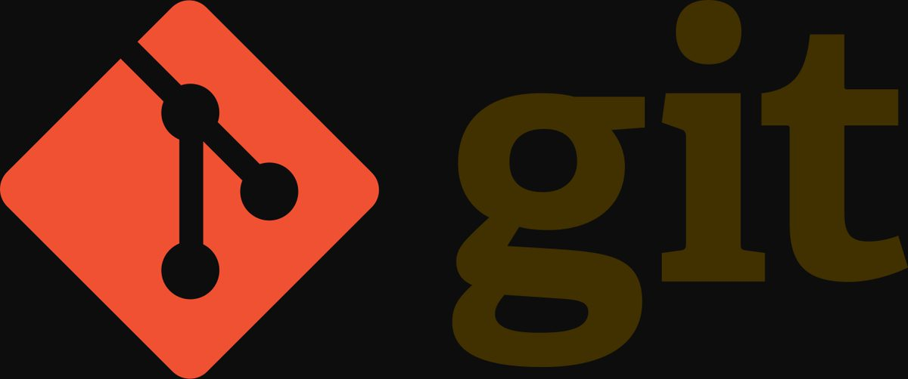
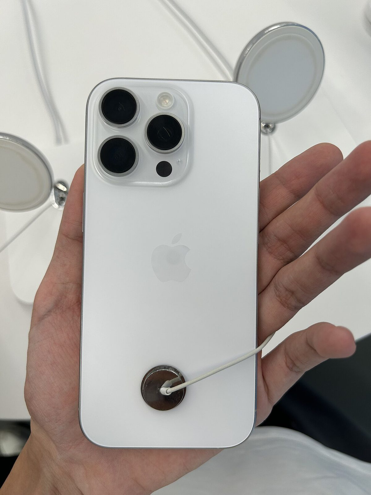
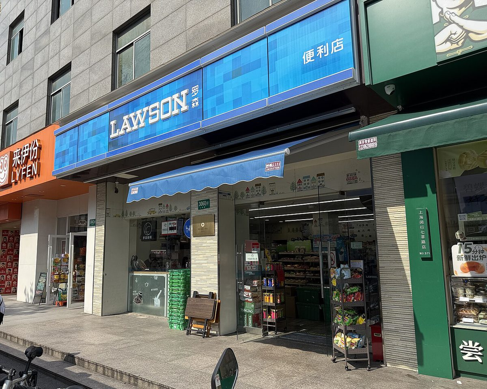
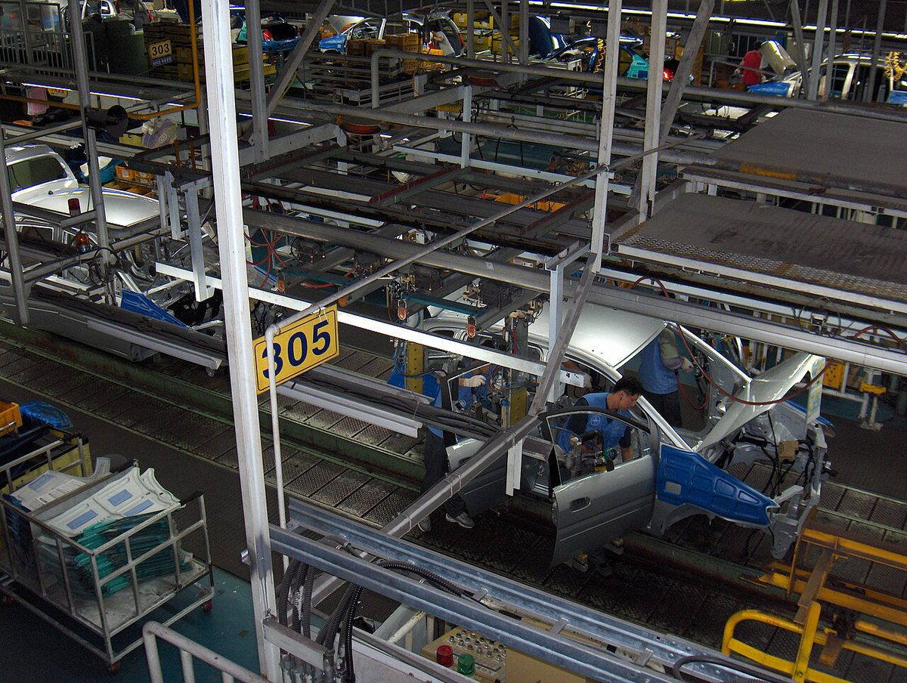

上一篇写 MIT 那个「只改 0.016% 权重就让 Qwen 数学翻 6 倍」的结果时，我把它当成了这一周最硬的进展。

48 小时后，这个结论被点名了。**spaCy 作者 Matthew Honnibal 发博文直接定性：那篇 post 是误导（misleading）**——注意，不是造假，是「把两种不同条件下的能力，包装成了一种统一的能力」。同一时间，OpenAI 在另一条完全相反的路上拿了分：它没有去改别人的权重，而是花 **120 万美元**、用一款还没发布的网络安全模型，在 Linux 内核里挖出 **948 个可提权到 root 的漏洞**。

一个在「把 AI 说得多神」这件事上退了半步，一个在「让 AI 干脏活」这件事上进了很多步。今天这一篇，把两件事都记下来。

## 一、48 小时后，神作被锤：不是造假，是偷换条件

先把被质疑的对象复述清楚，免得混淆。MIT 团队原帖的结论是：让前沿模型**不改梯度、不做训练**，直接编辑 Qwen3.5-0.8B 的权重，改动量仅 **0.016%**，在同样的采样设置下 MATH-500 从 **7.9% 升到 48.1%**（约 6 倍），而且没被要求优化的指令遵循能力（IFEval）也涨了 **3 倍**。

Matthew Honnibal 的反驳落在一条很具体的地方——**这两类实验根本不是同一个技术**：

| 实验 | 规模 | 是否读原始权重 | 是否用 Python | 是否运行目标网络 | 结果 |
|---|---|---|---|---|---|
| PPO MLP 猜游戏 | 1.7 万参数 | 是 | 否 | 否 | 4/4 |
| 扩散 MLP 猜形状 | 2.4 万参数 | 是 | 否 | 否 | 3/3 |
| 字符级 Transformer 认语言 | 720 万 | 否 | **是** | 否 | 3/3 |
| Kinetix 赛车策略修复 | 17.2 万 | 是 | 否 | 否 | 0% → 100%（改 3.5% 权重） |
| MinAtar 小游戏「从零写」 | 2 万 | **无权重可读** | 否 | 否 | 见下文 |
| Gemma 3 270M 识别谄媚 | 2.7 亿 | 否 | 是 | 否 | **失败**（改看注意力后 3/3） |
| Qwen3.5-0.8B 提升数学 | 8 亿 | 否 | 是 | **是**（最多 50 次前向） | 7.9% → 48.1% |

看清这张表就读懂了争议：**真正「把原始浮点数直接喂进上下文、不许写代码、不许运行网络」的读权重实验，规模只有 1.7 万到 17.2 万参数**。而所有涉及真实语言模型的实验都用了 Python，最出彩的那个 Qwen 实验还额外拿到了**最多 50 次前向调用**的实测反馈——那已经是「写代码 + 反复试错」，不是「读心」。

Honnibal 的定性因此不是「数据有问题」，而是「呈现方式有问题」：把 17 万参数上的读脑术，和 8 亿参数上带试错的工程优化放进同一篇 post，读者会自然得出「AI 已经能读写任意大模型的权重」这个结论——**而他自己用同一套方法在 Gemma 3 270M 上复现失败了**。

还有一处选择性问题值得记：宣传里的「从零写权重的小游戏网络打败 PPO」，实际只在 **Breakout** 上赢（517 分 vs PPO 5 亿步的 25 分），在 **Seaquest 是 53 vs 89、Asterix 是 53 vs 55，都输了**。

他也明确让了步：这件事依然了不起——一两年前的模型在这些任务上全会失败。Astra 真正证明的是「**它能被提示着去干一个人类 ML 工程师的活**」，这是工程突破。争的只是别把它说成超能力。

截至目前，MIT 作者与第三方都没有公开回应。所以这篇的结论只能是：**「存在一处实质性质疑，尚无回应」**，不能写成「已被推翻」。

这件事给我一个很实际的教训，也写在这里存档：**模型能力类新闻的「48 小时法则」**——第一天看结论，第二天看有没有人复现，第三天再决定要不要引用。我上一篇引用得太快了。

## 二、OpenAI 用 120 万美元，在 Linux 内核里挖出 948 个 root 漏洞

如果第一节是「收着说」，这一节就是「放开了干」。

OpenAI 披露了一次完整的内核漏洞挖掘行动：用一款**尚未发布**的网络安全模型加一条自动化流水线，在 Linux 内核里确认了 **948 个**可本地提权到 root 的漏洞（LPE），总花费 **120 万美元**，平均每个洞 **1279 美元**。

对比尺度是这样的：在 AI 介入之前，顶尖人类安全研究员一年在内核里能找出约 **20 个**同类漏洞。这次用了 **10 天**，产量相当于人类大约 **50 年**。按 Pwn2Own 的历史奖金折算，这 948 个漏洞的悬赏价值在 **1890 万到 6630 万美元**之间——投入 120 万，产出至少 15 倍。

真正值得学的是它的四段流水线设计，而不是「AI 又行了」：

| 阶段 | 成本 | 产出 | 关键指标 |
|---|---|---|---|
| Scout 侦察 | **3426 美元** | 从 4000 万+行代码里圈出 280 万行高价值目标（约 7%） | 把攻击面砍到 1/14 |
| Analyst 分析 | **31.6 万美元** | 12 小时产出 2308 个疑似漏洞 | — |
| Triage 分类 | — | 30 小时内真实环境复现 1724 个内核崩溃 | 命中率 **74.7%**，纯脑补误报仅 **3.1%** |
| ExploitDev 利用 | — | 291 个信息泄露 PoC + 1169 个提权 Exploit，去重后 948 个独立 LPE | 单个可用 root 利用平均 **359 美元** |

有两个细节比总数更吓人。

第一，**抽样 166 个利用，AI 自己发明了至少 10 种全新的内核攻击技术**：2 种内核缓存精准堆喷射的持久弹性对象、2 种提升稳定性的页编排（page grooming）、5 种任意写/篡改数据结构的数据流手法、1 种全新的任意类型混淆。外部资深内核专家给出的评价是「闻所未闻」。

第二，早期测试里，要求模型针对「分配到的漏洞」写利用，**200 个打通案例中有 20 个根本没用到指定漏洞**——智能体自己顺手挖了一个新的 0-day 拿到了 root。这不是流程失误，这是能力外溢。

纵向对比更能看出曲线：2026 年 7 月用 GPT-5.6 Sol 跑同一份代码，花 **50 多万美元**找出 **166 个**；三个月后换新模型，战果 **5 倍多**。

防守侧也在动。研究员 Eric Wallace 表示用 **Patch the Planet** 项目以纯公益方式投入前沿算力，管线已接入 Firefox 与 Chrome，近期帮 Firefox 修了 **40+** 个漏洞；10 天窗口内社区已在上游修补 **61 个**相关 LPE、**43 个**补丁在暂存区测试、近 **300 个**在邮件组讨论。

**这条新闻的正确读法是：漏洞发现的边际成本被压到 359 美元一个的时候，「有多少洞」就不再是安全问题，「多久能补完」才是。**

## 三、Codex 收购 Pierre：不满足于调用 Git，直接把 Git 买下来

11 月 4 日，OpenAI 宣布收购 **Pierre Computer Company**（尚需监管批准，交割前双方独立运营）。这是官方公告，不是传闻。

Pierre 的来历不简单：CEO 兼联创 **Jacob Thornton** 是 Bootstrap 的联合作者之一，另一位联创 Ian Ownbey，公司 2023 年成立、团队 11–50 人、累计融资约 **2400 万美元**。它的产品线是一套「代码存储 + diff 工具」：商业化主力 Code Storage，加上开源的 Diffs、Trees、DiffsHub——后两个其实早就用在 Codex 的文件浏览和 diff 审查界面里了。

Code Storage 的指标按 Git 托管的标准看相当夸张：

| 维度 | 指标 |
|---|---|
| 单仓库上限 | **32 TB** |
| 仓库数与总量 | 不限 |
| 读写性能 | 实测单仓库 **>500 次 Git 请求/秒**，API 峰值 **>1.5 万次/秒**，**30+** 并发写入 |
| 可用性 | **99.99%** SLA，Git 三阶段提交 + 辐条式 quorum |
| 定价 | 7 天内热数据 **0.005 美元/GB/小时**，超 7 天冷数据 **0.0002 美元/GB/小时**（相差 25 倍） |

**为什么一家做模型的公司要买代码存储？** 因为 Agent 写代码的速度已经撞上了 Git 本身的设计假设：一个仓库几十万个分支、一天几万次提交、每个 Agent 都要独立工作区——这是 Git 从没为之设计过的负载。OpenAI 在公告里的说法是让 Git 工作流适配「人 + 智能体」协作，覆盖「从智能体创建第一个分支到部署上线」。

换句话说，**Codex 的竞争对手不再是别的代码助手，而是 GitHub 和 GitLab 的地基**。而这两家恰好也是 OpenAI 最紧密的合作伙伴（微软）和最大的外部变量。这笔收购真正买的不是技术，是「以后 Agent 提交代码的那条主干道」。

## 四、GPT-Image-2.6：把「构图」和「画质」拆成两个旋钮

11 月 5 日，GPT-Image-2.6 全量上线，同时进了 ChatGPT、Codex 和 API，免费与付费用户都能用。

关键数字和机制：

| 变化 | 具体 |
|---|---|
| 速度 | 整体生成时间缩短 **50%**，最快 **6 秒**出图 |
| 原生格式 | 直接生成 **GIF** 动画、原生导出 **SVG** 矢量 |
| API 型号拆分 | **Flare**（速度与排版向，海报/电商产品图，低画质档 6 秒/张）、**Sunburst**（中高画质，细节精度与多轮修改一致性） |
| 参数解耦 | 新增 **complexity** 控制「动笔前的场景规划算力」，原 **quality** 只管视觉细节与保真度 |
| 能力下放 | 局部圈选重绘（Image markup）首次从网页端开放给 API，支持坐标或遮罩 |

两个工程细节值得单独说。

**GIF 不是用视频模型做的。** 它借的是游戏工业的 **sprite sheet（序列帧图集）** 思路：提示词要求「严格 6 个连续帧、3 列 × 2 行网格、固定前侧四分之三机位、第六帧平滑回到第一帧、无字幕无边框无留白」，再切片合成 GIF。这条 trick 的好处是每一帧都还在图像模型的能力范围内，不碰时序一致性的硬骨头。

**complexity 与 quality 解耦，思路和文本模型的「推理深度」调节是同一件事。** 日常局部改图可以 low complexity + 高 quality——省掉重新构图的开销，只渲染变化的那块。这是把「思考」和「渲染」分开计价的第一次，产品意义大于跑分意义。

One more thing：**GPT-6.2 Astra 已经现身谷歌云**。上一周它还在 OpenAI 自己的灰度里，500 美元 Pro 套餐才抽得到。

## 五、国行 Apple 智能上线：Siri 的搭档是千问（11 月 4 日）

等了两年，国行 Apple 智能终于落地。11 月 4 日苹果推送 **iOS 27.3** 开发者预览版，中国大陆的「Apple 智能与 Siri」上线，支持 **iPhone 15 Pro 及更新机型**；合作方是**阿里巴巴**，部分体验接入**千问**。

接入方式和海外版有本质差别：

| 维度 | 国行版 | 海外版 |
|---|---|---|
| 模型来源 | 阿里巴巴千问（部分能力） | 苹果自研 + OpenAI |
| 使用方式 | 登录千问账户或「通过 Apple 登录」，**无需跳转独立 App** | ChatGPT 集成需授权跳转 |
| 首批能力 | 实时翻译（信息/FaceTime/电话）、写作工具（改写/校对/摘要）、视觉智能、照片消除 | 同一批，语言与时区差异 |
| 硬件延伸 | AirPods 4 与 AirPods Pro 2 及后续机型支持面对面翻译 | 相同 |
| 覆盖系统 | iOS / iPadOS / macOS / visionOS | 相同 |

几个值得注意的背景数字：苹果称 **Siri 日均处理请求超 25 亿次**，并明确表示**云端高级 AI 功能未来可能转为付费**；同时苹果正在向所有开发者开放 Siri AI 集成。

**但同一天也出现了相反方向的信号：苹果在收紧自己的 AI 预算。** 据彭博社报道，苹果上月把部分工程师的每日 AI 开支上限从 **300 美元降到 200 美元**，并考虑把部分工程团队进一步降到 100 美元；非工程部门许多团队原本就是 100 美元，还讨论过把部分团队压到 25 美元。

一边给用户免费送 AI，一边给自己人砍 AI 额度——这两件事放在一起，说明**AI 的成本结构正在从「研发投入」变成「运营支出」，而运营支出是要被财务管控的**。

## 六、AI 预算的两极：大厂在砍，高校在发

把这个信号和另外几条放在一起，画面更清楚：

| 主体 | 动作 | 数字 |
|---|---|---|
| 苹果 | 收紧内部 AI 开支（据彭博社） | 工程师每日 **300 → 200 美元**，部分团队拟降至 100，个别讨论 25 |
| 字节（传闻，未官方确认） | 禁止外部 AI 访问核心资产 | 11 月起全公司 **L4 级代码仓库与飞书文档**禁外部 AI；员工自购的 Claude、Codex 账号不可用 |
| 思科 | 反向操作 | 给一名 **27 岁**工程师**无限 Token**，让他重写陈旧代码 |
| 中国科学技术大学 | 给师生发算力 | 「词元计划」全体师生**每人每天 1 亿 Token**，次日清零重置，可调 DeepSeek、GLM、千问 |
| 同济大学 | 同上 | 每周 **1 亿 Token**（标题口径） |
| 北京邮电大学 | 同上 | 已提供免费 Token 或算力账户 |

**同一个技术，在不同的组织里被算进完全不同的账。** 苹果把它当运营成本压；思科把它当技术债的重组资本；高校把它当公共基础设施。这三者的差别，比模型跑分更能预测未来两年的行业格局——因为真正决定 AI 落地速度的，不是能力上限，是**谁在为 token 买单**。

顺带一条独立的隐私信号：上海人工智能实验室 AgentDoG 团队发布了一项基于 **67950 条工具调用记录**的研究，指出泄露风险不在「你对 Agent 说了什么」，而在「Agent 替你调用了什么」——查路线就连上地图，整理体检报告就连上健康数据库。这条线索未来会变成 Agent 产品的合规刚需。

## 七、具身智能的两个刻度：8 小时 5 分钟，和「24 小时后 2 台没转正」

这半个月国内具身智能给出了两个非常有画面感的对照实验：

| 项目 | 场景 | 关键指标 | 结论 |
|---|---|---|---|
| 小米 CyberOne 02 | 汽车总装车间，中控台侧盖板排序 | 累计作业 **8 小时 5 分钟**，中途**两次充电**；两台随产线节拍运转 | 连续作业能力的「工时」刻度 |
| 智元精灵 G2 | 上海徐汇一家便利店，11 月 2 日 10 时起 | **6 台**机器人分工顶班，直播营业 **24 小时** | 6 台中 **2 台「转正」失败** |

小米给的是**「时长 + 充电次数」**，这是一个可以被产线直接验收的指标：工件是大尺寸、形态不规则的柔性件，要按车型上线顺序取件、调姿态、放进料架对应格口——能连干 8 小时，意味着它开始接近「一个班次」。

智元给的是**「24 小时班次 + 转正考核」**，六台机器人各有分工（迎宾、补货、巡视、咖啡、收银熟食、清洁），商业零售场景的复杂度在于长尾异常：地面有水、顾客插话、货架错位。2/6 的失败率放在「替代店员」这个目标下不算好看，但放在「真实门店连续运转」这个标准下，24 小时无人接手本身就是数据。

**这两个数字都不构成「通用能力」结论，但它们比任何 benchmark 都更接近商业化**——因为客户要买的不是「会不会」，是「能不能连着干一个班次而不出事」。

## 八、其他同日信号

- **Anthropic**：修订版 S-1 披露，2026 年 7–9 月 **5300 名员工**的相关成本**超过 17 亿美元**，三个月人均超 **32.2 万美元**、平均每月约 **10.7 万美元**（公司承担的总成本口径，非单纯薪资）。同时公布国际零售发行参与机构名单，向**澳大利亚、加拿大、日本、瑞士、英国**及欧洲经济区部分国家的散户开放认购（加拿大含 Wealthsimple，日本含三菱日联摩根士丹利、瑞穗、乐天、SBI）。IPO 前夕，其「产品一姐」被曝转投 OpenAI。
- **百度**：11 月 5 日开源 **ERNIE 5.5 Flash Base**，MoE 架构、总参数 **2800 亿**、每 token 激活 **140 亿**、预训练 **33.5 万亿 token**、预训练上下文 **128K**、微调与推理支持最长 **100 万 token**；低秩门控注意力让门控投影参数**减少 75%**。需要注明：**「同尺寸 SOTA」属百度自述，文中未给出具体分数**。
- **微信**：开源 **WeVisOne-VL** 视觉模型。
- **腾讯**：混元 **Hy4** 正式版发布，新增视觉与电脑操控能力；同时发布科研 Agent 平台 **Hyra 2.0**，主打从「解题」走向「造工具」。
- **DeepSeek**：Harness 加入**创作者模式**，可用对话直接做插件；据报道 **V5 计划基于华为昇腾算力训练**（未证实，勿当官方口径）。
- **Kimi**：发布游戏开发方案，可操作引擎并交付原生工程。
- **Google**：Antigravity 上线**插件市场**，接入 Figma、Jira 与生产日志。
- **Reddit CEO**：直说 Google **AI Mode 没有给网站带来流量**——这是「AI 摘要吃掉点击」第一次由合作方高层公开确认。
- **OpenAI**：发布 **LifeVal** 评估（11 月 2 日），任务设计参考美国与跨国「时间使用调查」，另调查 **3995 名**代表性受访者，覆盖照护、健康、教育、家庭行政、个人财务、购物、政府服务；公开示例得分为找幼儿园 **93.1%**、组织社区防洪志愿者 **98.0%**、为糖尿病家人备餐 **90.4%**。注意：这仍是**内部评估**，完整任务集、评分代码与误差范围未公开，媒体标题里的「1.7 万亿美元」属标题化表述。
- **AMD**：数据中心收入接近翻倍，第四季度营收指引 **170 亿美元**。
- **游族**：拟花 **42.25 亿元**采购 GPU，相当于三年收入。
- **尹希**：官宣离开 OpenAI。

## 九、11 月 3–4 日大事补记

| 日期 | 事件 | 关键数字 |
|---|---|---|
| 11 月 3 日 | DeepSeek 再次大规模中断 | 16:58 起网页端与 API 同步失效，年内至少第 **19** 次；官方次日回应已修复 bug，部分服务性能仍下降 |
| 11 月 3 日 | 苹果发布 2026 财年第四财季财报 | 营收 **1144.8 亿美元**（+12%）、EPS 2.10 美元、毛利率 47.9%，均超预期；存储涨价压制毛利，股价下跌 |
| 11 月 3 日 | 小米机器人乌镇双料获奖 | 集团获杰出贡献奖（创新突破类），具身基座模型获领先科技奖 |
| 11 月 3 日 | 中科曙光 8000 真机亮相乌镇 | 中国首个**全国产十万卡** AI 超集群 |
| 11 月 3 日 | 阿里巴巴 Qoder 获领先科技奖 | 服务超 **800 万用户、10 万家企业** |
| 11 月 3 日 | 高盛限制内部 AI 工具 | 禁止大部分员工使用编程类先进 AI，此前允许 Claude Code 与 GitHub Copilot |
| 11 月 3 日 | 马斯克承认收紧 Grok Bot 额度 | 原因是智能体服务成本难以为继 |
| 11 月 4 日 | **国行 Apple 智能上线** | iOS 27.3 开发者预览版，iPhone 15 Pro 及更新机型；千问接入 Siri、写作工具、视觉智能 |
| 11 月 4 日 | **腾讯混元 Hy4 正式版** | 新增视觉与电脑操控能力 |
| 11 月 4 日 | 百度首次披露 **Apollo World** 世界模型 | 萝卜快跑端到端已投入运营 |
| 11 月 4 日 | 智元机器人便利店「转正」结果公布 | 6 台连续营业 24 小时后，**2 台**未通过 |
| 11 月 2–4 日 | OpenAI 发布 **LifeVal** 评估 | 发布日为 11 月 2 日、11 月 4 日起被广泛报道（报道日期不一）；覆盖 7 类日常任务，3995 名受访者参与设计 |
| 11 月 4 日 | Meta 计划发行至少 **200 亿美元**跨境债券 | 用于扩建 AI 基础设施 |
| 11 月 4 日 | 苹果表态 | Siri 日均请求超 **25 亿次**；云端高级 AI 未来或转付费 |
| 11 月 4 日 | 姚顺宇否认创业 | 称目前仍是 DeepMind 员工 |
| 11 月 4 日 | 网络安全的「AlphaGo 时刻」 | **466 场** Agent 对局实验引发讨论 |
| 11 月 4 日 | 思科给 27 岁工程师无限 Token | 用于重写陈旧代码 |

## 十、总结：这三天最贵的三堂课

**总结：** 11 月 3 日到 5 日，行业分别上了一节关于「引用」「成本」和「地基」的课。

1. **引用有成本，复现有周期。** MIT 那件事的教训不是「MIT 做错了」，而是**新闻周期的速度已经超过了科学验证的速度**。一篇博客 48 小时内就能被同领域专家指出「两种能力被混为一谈」，而绝大多数转载永远不会更新。做技术判断的人，需要自己把「48 小时法则」内建到流程里。

2. **AI 的账已经从「投入」切换到「管控」。** 苹果把工程师的日额度从 300 降到 200、字节传闻禁止外部 AI 碰 L4 仓库、高盛禁掉编程类 AI 工具——**同一周里三家大公司都在收紧**；而高校在发每人每天 1 亿 Token、思科给一个人无限 Token。分化点不在技术，在**谁能把 token 变成可核算的产出**。

3. **Agent 时代的地基正在被重买一遍。** OpenAI 收购 Pierre 是为了让 Git 接得住「一天几万次提交、每个 Agent 一个分支」；DeepSeek 开源 Super-agent 是为了让调度扛住「一个人只能同时盯 3–5 个会话」；OpenAI 在 Linux 内核挖 948 个洞，是把安全也变成流水线。这三件事的共同点是：**价值正在从模型层迁移到「模型运行时」这一层**——谁的 harness、存储、打包、修补做得扎实，谁就能把会掉价的能力卖成不会掉价的基础设施。

最后留一个具体的判断：当一个 root 漏洞的发现成本降到 **359 美元**、当一个 8 亿参数模型的能力改动可以 50 次前向试错就完成，**「AI 能做到什么」的新闻会越来越便宜，「AI 做到之后谁来兜底」的问题会越来越贵**。

---

## 参考链接

- [Matthew Honnibal：The "Astra can read and write weights to improve Qwen" post is misleading](https://honnibal.dev/blog/astra-read-write-misleading)
- [原始工作：Weight-Space Programming](https://rikiyat.github.io/blog/weight-space-programming/)
- [量子位：MIT 神作被锤：Astra 爆改 Qwen 权重？就吹吧！](https://www.qbitai.com/2026/11/507782.html)
- [OpenAI：A thousand fewer paths to root](https://openai.com/index/a-thousand-fewer-paths-to-root/)
- [量子位：Linux 内核被挖出 948 个漏洞！OpenAI 花 120 万美元找到的](https://www.qbitai.com/2026/11/507697.html)
- [OpenAI：Introducing GPT-Image-2.6](https://openai.com/index/introducing-images-2-6/)
- [量子位：GPT-Image-2.6 全量上线！直出 GIF 和 SVG](https://www.qbitai.com/2026/11/507707.html)
- [Hugging Face：baidu/ERNIE-5.5-Flash-Base](https://huggingface.co/baidu/ERNIE-5.5-Flash-Base)
- [量子位：百度开源文心 5.5 Flash Base](https://www.qbitai.com/2026/11/507787.html)
- [量子位：尹希官宣离开 OpenAI](https://www.qbitai.com/2026/11/507757.html)
- [量子位：百度无人车搞出「黑客帝国」！世界模型实时推演全局](https://www.qbitai.com/2026/11/507647.html)
- [博客园新闻：刚刚，OpenAI 收购 Pierre，Codex 要对 Git 下手？](https://news.cnblogs.com/n/844637/)
- [博客园新闻：iPhone 国行 AI 真的来了，千问成为 Siri 新搭档](https://news.cnblogs.com/n/844594/)
- [博客园新闻：连夜实测 iPhone 国行 AI，亮点和槽点都在这了](https://news.cnblogs.com/n/844556/)
- [博客园新闻：Anthropic IPO 前披露人员开支：5300 名员工单季相关成本超 17 亿美元](https://news.cnblogs.com/n/844506/)
- [博客园新闻：Anthropic 拟向多国散户开放 IPO 认购](https://news.cnblogs.com/n/844612/)
- [博客园新闻：苹果收紧员工 AI 预算，部分工程师每日额度从 300 美元降至 200 美元](https://news.cnblogs.com/n/844609/)
- [博客园新闻：字节新规：限制使用 Claude、Codex 等外部 AI 工具](https://news.cnblogs.com/n/844533/)
- [博客园新闻：字节将大面积限制员工自费使用 Codex](https://news.cnblogs.com/n/844493/)
- [博客园新闻：多所高校免费发 Token，同济每周提供 1 亿 Token](https://news.cnblogs.com/n/844561/)
- [博客园新闻：便利店打工 24 小时后，智元两名机器人员工「转正」失败](https://news.cnblogs.com/n/844511/)
- [博客园新闻：雷军分享小米人形机器人「实习」新进展](https://news.cnblogs.com/n/844611/)
- [博客园新闻：你的 AI 助手正在「出卖」你：67950 条工具调用记录的隐私实验](https://news.cnblogs.com/n/844621/)
- [博客园新闻：DeepSeek V5：计划基于华为昇腾算力进行训练](https://news.cnblogs.com/n/844497/)
- [博客园新闻：今天，OpenAI 发布 AGI 新标准（LifeVal）](https://news.cnblogs.com/n/844519/)
- [IT 之家：LifeVal 评估相关报道](https://www.ithome.com/1/021/336.htm)
- [博客园新闻：微信开源 WeVisOne-VL 视觉模型](https://news.cnblogs.com/n/844613/)
- [博客园新闻：腾讯发布 Hyra 2.0，让科研 Agent 从解题走向造工具](https://news.cnblogs.com/n/844605/)
- [博客园新闻：腾讯混元 Hy4 正式版发布，新增视觉与电脑操控能力](https://news.cnblogs.com/n/844518/)
- [博客园新闻：DeepSeek Harness 加入创作者模式](https://news.cnblogs.com/n/844603/)
- [博客园新闻：Kimi 发布游戏开发方案](https://news.cnblogs.com/n/844602/)
- [博客园新闻：Google Antigravity 上线插件市场](https://news.cnblogs.com/n/844581/)
- [博客园新闻：Reddit CEO：Google AI Mode 没给网站带来流量](https://news.cnblogs.com/n/844579/)
- [博客园新闻：香港金管局推出 SAGE 项目，探索 AI Agent 购物与支付](https://news.cnblogs.com/n/844600/)
- [博客园新闻：AMD 数据中心收入接近翻倍](https://news.cnblogs.com/n/844563/)
- [博客园新闻：游族要花 42.25 亿巨款买 GPU](https://news.cnblogs.com/n/844587/)
- [博客园新闻：Anthropic 微微发力，AI 中转站的天就要塌了？](https://news.cnblogs.com/n/844552/)
- [博客园新闻：苹果称 Siri 日均处理请求超 25 亿次](https://news.cnblogs.com/n/844504/)
- [博客园新闻：Meta 计划发行至少 200 亿美元跨境债券](https://news.cnblogs.com/n/844505/)
